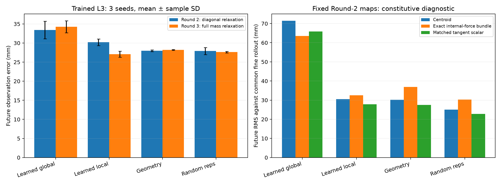

# PhySPRING — Independent Mac Reproduction

Independent PyTorch implementation of the main graph-reduction and physical-rollout ideas from **PhySPRING: Structure-Preserving Reduction of Physics-Informed Twins via GNN** (NeurIPS 2026), with CPU and Apple GPU execution.

**状态：第三轮三维受力与梯度核查已完成。局部学习式在子集主指标上小幅领先，但独立标注仍未超过几何对照；尚未完整复现论文。** 本项目不是作者代码；原文未披露的细节存在明确补全，不能把局部加速或训练成功解释为论文数值匹配。

[Paper](https://arxiv.org/abs/2605.07687) · [Author project](https://merealtea.github.io/PhySpringWeb/) · [实现假设](docs/assumptions.md) · [实验协议与覆盖](docs/experiment_protocol.md) · [首轮结果表](results/report/results.md) · [第二轮逐项核查](docs/round2_audit.md)



左图是同一真实布料子集的三种子训练比较；右图固定旧分组与初始细网格，比较三种受力缩减。两图的评估目标和误差定义不同，不能横向比较数值。

## 第三轮结果与入口

重点发现：标量 `PᵀLP` 无法一般性保存三维轴向弹簧的方向张量；但精确投影细边内力也没有普遍改善预测。另确认旧质量池化的 STE 梯度不保持常量位移，新实现保留完整投影质量矩阵及其反向传播。

18 次真实子集训练（六方案、三种子）及 1 次 GPU 训练全部完成；26 项测试通过。新局部学习式 L3 未来观测误差 **27.08±0.79 mm**，对照为几何 **28.21±0.12 mm**、随机代表 **27.63±0.20 mm**；旧局部为 30.19±0.87 mm。独立标注口径下新局部 **24.20 mm**，仍高于几何的 **23.41 mm**。

新全局合并未改善（34.24 mm）；只监督当前层的局部方案也未改善（28.25 mm）。权重/分组互换表明：保留旧分组而换新权重为 27.98 mm，保留旧权重而换新分组为 29.12 mm，不能把改善全部归因于新簇更符合真实运动。

[三维受力与梯度核查](docs/round3_audit.md) · [全部结果](results/round3/results.md) · [逐运行数据](results/round3/per_run.csv) · [检查点核验](results/round3/verification.json) · [独立标注](results/round3/sparse_gt.json)

```sh
python -m physpring.experiment_v3 --output results/my_round3 \
  --data data/double_lift_cloth_1_64_round2_aligned.pt --epochs 80 --substeps 16 \
  --projection full --merge local --supervision cumulative
python scripts/run_round3.py
python scripts/audit_axial_reduction.py
python scripts/audit_axial_reduction.py --group round3 --levels 3
python scripts/audit_projection_gradients.py
python scripts/audit_multilevel_gradients.py
python scripts/audit_map_parameter_swap.py
MPLCONFIGDIR=/tmp/physpring-mpl python scripts/report_round3.py
python scripts/verify_round3.py
python scripts/evaluate_sparse_gt_v3.py
python scripts/check_mps_v3.py
```

本轮六路 CPU 并发；GPU 144 节点/16 轨迹训练约 77 秒、驱动内存峰值约 4 GB。另完成 667 子步两帧 CPU/GPU 梯度核验，**不代表完整 667 子步训练已完成或梯度已收敛**。精确细边受力保留在诊断模块，不作为作者方法或加速实现。

## 第二轮结论与入口（历史结果）

正式对照 24 次中 23 次完成、1 次失败；另保留 15 次掩码索引修正前的完整历史实验、1 次 GPU 训练和 1 次 32 子步重训，共核验 40 份完整结果。19 项测试通过；全部 CPU 检查点轨迹重建误差为 0，GPU 检查点转 CPU 重建最大差约 2.01e−5 m。

| 方案 | L3 未来观测追踪误差（三种子，mm） |
|---|---:|
| 旧版学习式合并 | 40.28 ± 11.88 |
| 修正后全局学习式合并 | 33.41 ± 2.31 |
| 修正后局部学习式合并 | 30.19 ± 0.87 |
| 相同新设置：几何代表 | 27.97 ± 0.22 |
| 相同新设置：随机代表 | 27.91 ± 0.92 |

局部学习式方案相对旧版均值降低约 25%，但没有超越新基线。细层误差也并非全面改善：旧版 L0 为 20.84 mm，新局部方案为 27.23 mm。不能把物理形式更接近公开基准解释为数值结果一定更好。9 条独立标注轨迹的附加评估同样没有显示学习式优于几何；它采用初帧 3-NN 位移插值，并非官方完整评估器。

- **冻结错误得到直接确认**：旧版三个种子结束时分别换了 22/15/22 个节点的粗层簇；新流程冻结实际受监督的图，换簇数为 0。
- **轴向物理的缩减仍不精确**：标量 Galerkin 投影精确，三维切线响应却不同；初始图诊断偏差约 21%–41%。局部约束减少不连通簇，但不保证连通，更不是作者已披露规则。
- **积分稳定性仍要监控**：physics_only seed2 在 16 子步第 67 轮发散，32 子步从头重训完成 80 轮，L3 为 28.79 mm；该重训不替代正式失败记录。
- **本地资源已实测利用**：六路 CPU 实验并发；Apple GPU 的 144 节点、16 轨迹训练约 167 秒、驱动内存峰值约 4 GB。短批量物理测试 CPU/GPU 最大位置差约 3e−7 m，144 节点/32 轨迹前向反向约快 4.5 倍（并发负载下的单次测量）。

[完整消融表](results/round2/results.md) · [逐运行 CSV](results/round2/per_run.csv) · [独立标注评估](results/round2/sparse_gt.json) · [核验记录](results/round2/verification.json) · [冻结审计](results/round2/topology_freeze_audit.json)


新入口 `physpring.experiment_v2` 实现轴向阻尼、指数速度衰减、地面冲量与碰撞时刻积分、单向几何损失、独立且按运动区间对齐的追踪掩码，以及确定性尾段训练后冻结实际受监督的拓扑。全局/局部合并、加性/乘性参数头、旧/新物理及损失均可单独选择。

```sh
python scripts/prepare_round2.py
python -m physpring.experiment_v2 --output results/my_round2 \
  --data data/double_lift_cloth_1_64_round2_aligned.pt --epochs 80 --substeps 16 \
  --physics reference --loss reference --schedule deterministic_tail --heads additive --merge local

# 固定对照及掩码校正后的重跑；失败现场和旧结果保留。
python scripts/prepare_round2.py --legacy-mask
python scripts/run_round2.py --workers 6
python scripts/run_round2.py --aligned --workers 6
MPLCONFIGDIR=/tmp/physpring-mpl python scripts/report_round2.py
python scripts/verify_round2.py
python scripts/evaluate_sparse_gt_v2.py
python scripts/check_mps_v2.py
```

详细规则、数值失败与原文尚未披露的实现细节见[第二轮核查](docs/round2_audit.md)。`results/round2_aligned/` 保存最终新损失实验；`results/round2/` 中的同名新损失实验是掩码时序修正前的历史结果。`--legacy-mask` 仅供重建旧审计数据，正式新实验使用默认的时序校正版。

## 首轮结论（历史结果）

正式对照共27次（18次合成、9次真实子集），另有1次GPU大批量训练、1次恢复后的64子步敏感性，共29份完成结果。7项测试通过；两个检查点抽查重建误差为0。

真实布料子集3种子的未来观测追踪误差：

| 方案 | L0（68节点） | L3（20节点） | L3/L0本地吞吐 |
|---|---:|---:|---:|
| 学习式聚合 | 20.84 ± 6.73 mm | 40.28 ± 11.88 mm | 2.01× |
| 几何聚合 | 23.60 ± 6.18 mm | 21.94 ± 2.60 mm | 2.01× |
| 随机聚合 | 21.26 ± 5.62 mm | 32.92 ± 3.36 mm | 2.30× |

**判断：核心可执行，缩减能减少本实现的积分成本；学习式拓扑的质量优势未复现。** 不能将这组2倍加速与论文的2.30倍视为数值匹配。64子步的最后10轮重训也没有明显修复seed0的L3质量（约51.89mm，对比16子步约52.30mm）。

首轮留下的合并规则、非线性轴向缩减、接触与阻尼差异已进入第二轮核查。没有证据表明仅增加训练轮数就能解决差距。

## 实现范围

- 节点/边消息传递、30维位置编码、128维特征、多层编码/解码与跳接。
- 基于潜在距离的Gumbel-Softmax/STE聚合，以及质量、刚度、完整阻尼矩阵的Galerkin投影。
- 多层机械参数修正、固定控制节点、可微轴向弹簧积分与地板罚力。
- 质量加权状态投影、静止偏移恢复、追踪/Chamfer监督、逐层拓扑固定。
- CPU双精度物理/梯度验证，Apple MPS数值对齐和大批量训练。
- 合成布料/绳索18次多种子对照；真实PhysTwin布料9次（含异常恢复）对照；积分子步敏感性和额外稀疏标注追踪检查。

**未完成**：完整场景与点数、官方PhysTwin两阶段训练、严格匹配的Gramian MOR、粒子自碰撞、原始3DGS外观及图像指标、ACT/π0机器人闭环。因此论文表1–4和附录机器人结果均不能标记为已复现。

## 安装

Python 3.12。记录环境为 macOS / Apple M4 Pro / 48GB；依赖锁定文件只代表本次环境。

```sh
python3.12 -m venv .venv
source .venv/bin/activate
python -m pip install -r requirements-lock.txt
python -m pip install -e . --no-deps
python -m pytest -q
```

Apple GPU须运行在能访问Metal的本地进程中。若 `torch.backends.mps.is_available()` 为false，检查运行环境的设备访问权限；程序不会把 `--device mps` 静默改为CPU。

## 快速独立训练

```sh
python -m physpring.experiment --output results/my_cloth \
  --kind cloth --strategy learned --seed 0 --epochs 80 \
  --size 6 --frames 32 --batch 3 --substeps 16 --hidden 128
```

输出目录必须为空。每次保存配置、原始目标、逐轮日志、检查点、预测轨迹和源码。`--strategy geometry` 或 `random` 切换聚合对照；它们共享同一GNN和优化方案，不是官方PhysTwin。

## 获取真实数据

```sh
python scripts/download_data.py --cases double_lift_cloth_1
python scripts/prepare_real.py --case double_lift_cloth_1 --nodes 64
python -m physpring.experiment --output results/my_real \
  --data data/double_lift_cloth_1_64.pt --epochs 80 --substeps 16 --seed 0
```

下载器从[公开PhysTwin数据](https://huggingface.co/datasets/Jianghanxiao/PhysTwin)的8GB ZIP中按HTTP Range提取4个所需成员，约28MB解压数据；CRC由zipfile校验，SHA-256记录于 `sources/download_manifest.json`。没有未来帧参与点采样。保留官方train=[0,81)、test=[81,116)划分，以及 `reverse_z` 坐标变换。数据版权归原提供者；不随代码分发原始观测。

主报告使用有效观测追踪误差；额外 `scripts/evaluate_sparse_gt.py` 使用9条独立标注轨迹，以初帧3近邻位移插值预测。该插值评估也未声称与官方评估器完全一致。

## 重建实验与缓存

```sh
# 默认复用已经完成的结果；新输出根目录用于完整重算。
python scripts/run_suite.py --output-root results/my_suite
python scripts/run_real.py --output-root results/my_real_suite

# Apple GPU较大批量；本次已运行的配置。
python -m physpring.experiment --output results/my_gpu --device mps \
  --epochs 80 --size 12 --frames 24 --batch 16 --hidden 128 --substeps 8

# 重新生成已有正式结果的图表及逐运行CSV。
MPLCONFIGDIR=/tmp/physpring-mpl python scripts/report.py
python scripts/evaluate_sparse_gt.py
python scripts/verify_results.py
```

`run_suite.py` / `run_real.py` 使用6个工作进程，每个进程1个计算线程。图表脚本目前读取已交付的 `suite_final`、`real_final`、`real_repaired_0`；自定义根目录重算后，应明确更新图表输入路径，避免混合轮次。

## 数值与性能复核

```sh
python scripts/check_mps.py
python -m physpring.evaluate results/real_final/learned_1 --substeps 8 16 32 64 667
```

小系统CPU更快；144节点、32轨迹的单次前向/反向微基准中MPS约快2.7倍，CPU/MPS最大位置差约1.8e-7。该微基准包含初始化开销。完整144节点、16轨迹GPU训练80轮约70秒，驱动内存记录峰值约2.6GB。绝对时间随并发负载变化。

本地层间推理FPS包含投影/积分/恢复，但不含图像渲染；与论文RTX4090端到端FPS不同。真实数据训练16子步也不同于论文667子步。更细子步的前向误差收敛不能证明训练梯度已收敛。

## 异常恢复与证据

真实seed0原运行在第79轮损失非有限。审计定位第70轮所有梯度元素仍有限，但FP32范数溢出；16/32/64子步的FP64范数分别约1.19e27、2.62e13、3.06e5，说明反向积分强烈依赖时间步。

修复只在范数溢出时使用CPU双精度计算裁剪比例，真正非有限梯度仍停止。`real_repaired_0` 从异常前第70轮恢复至80轮，并保留前69轮日志与恢复来源。**修复了计算溢出，不意味着消除了梯度病态或恢复论文表现。** 另有最后10轮改64子步的敏感性实验，不并入标准三种子均值。

```sh
python -m physpring.experiment --output results/my_recovery \
  --data data/double_lift_cloth_1_64.pt --epochs 80 --substeps 16 --seed 0 \
  --resume results/real_failure_audit/last_state.pt
```

历史试跑位于 `pilot_*`、`suite`、`real_pilot`、原失败的 `real_final/learned_0`。正式汇总排除它们。较早运行的 `source_hashes.json` 是运行结束时的文件哈希；`results/source_versions/`保留匹配的训练入口版本。最终入口在启动时复制完整源码至运行目录，避免长任务期间文件编辑影响溯源。

## 结果索引

- `results/report/results.md`：逐数据/方法/层的均值与标准差。
- `results/report/per_run.csv`：全部正式逐种子数值及来源。
- `results/report/sparse_gt.json`：独立标注轨迹评估。
- `results/hardware_benchmark.json`：CPU/MPS物理和梯度对齐。
- `results/real_failure_audit/gradient_audit.json`：异常状态的梯度与时间步对照。
- `results/real_final/learned_1/substep_sensitivity.json`：包括667子步的四层前向核验。
- `docs/assumptions.md`：所有实现偏离、未知设置和未覆盖内容。

本文保留发布前的详细实验记录；当前仓库与公开复跑入口见 README.md。
