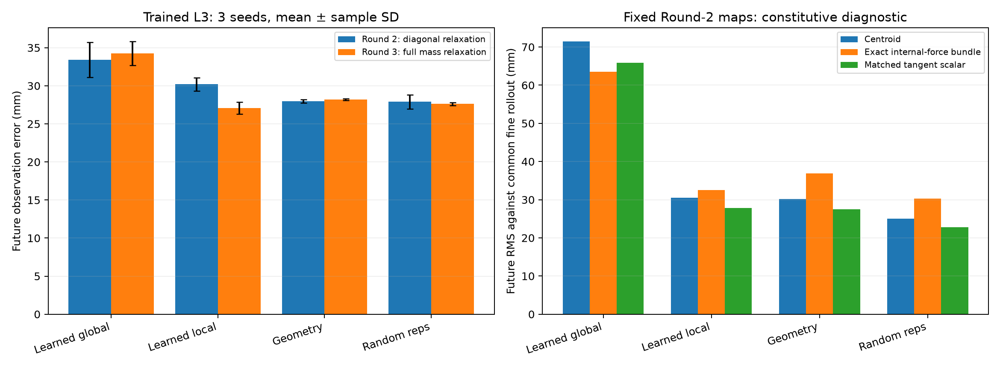

<div align="center">

<h1>PhySPRING: Structure-Preserving Reduction of Physics-Informed Twins via GNN [Reproduction]</h1>

<p><strong>Graph reduction · Differentiable physics · Structure preservation</strong></p>

<p>Independent implementation · Reproducible evidence · Transparent limitations</p>

<p>
<a href="https://arxiv.org/abs/2605.07687"></a>


<a href="https://github.com/gulucaptain/PhySPRING-Reproduction/actions/workflows/ci.yml"></a>
<a href="LICENSE"></a>
</p>

<p><a href="https://arxiv.org/abs/2605.07687">📄 Paper</a> · <a href="results/round3/results.md">📊 Results</a> · <a href="docs/round3_audit.md">🔍 Audit</a> · <a href="docs/assumptions.md">📐 Scope</a></p>

</div>

## 🎯 Reproduction at a glance

| | Scope & evidence |
|:--|:--|
| 🧩 **Implemented** | Hierarchical GNN reduction, mechanical projection, frozen topology and differentiable rollouts. |
| 🧪 **Validated locally** | Three local rounds · 18 latest real-subset runs · force/gradient and replay audits. |
| 🔎 **Remaining gaps** | One cloth subset; independent tracks still favor geometry. Full paper benchmarks remain incomplete. |

> [!IMPORTANT]
> This is an independent, partial reproduction—not the authors’ official implementation. Local experiments do not establish full paper-result reproduction.

---

An independent PyTorch implementation and audit of **PhySPRING: Structure-Preserving Reduction of Physics-Informed Twins via GNN**, with CPU validation and Apple Silicon GPU execution.

**Status: three local implementation/experiment rounds completed; the full paper benchmark and its claimed learned-reduction advantage are not reproduced.** The latest local learned model slightly leads the observation metric on one cloth subset, but still trails the geometric baseline on independent annotated tracks. This is not the authors' implementation.

## 🧩 Implemented

- Hierarchical GNN encoding/decoding, positional features, Gumbel–Softmax/STE assignments and progressively frozen topology.
- Mass, scalar stiffness and damping projection; additive mechanical parameter corrections; controller singleton constraints.
- Differentiable axial springs, axial dashpots, exponential drag, floor impulses and time-of-impact integration.
- Separate geometry/tracking masks with transition-aligned motion validity; observation and independent annotated-track evaluation.
- Full projected-mass derivatives, checked by finite differences and translation-invariance tests.
- Exact fine-edge internal-force projection and tensor-tangent diagnostics, plus fixed-map/weight-swap and supervision ablations.

The exact fine-edge force bundle is a diagnostic branch. It retains the original edges and is not presented as the paper's accelerated coarse-spring implementation.

## ⚙️ Installation

Python 3.12. Run from a fresh clone:

```sh
git clone https://github.com/gulucaptain/PhySPRING-Reproduction.git
cd PhySPRING-Reproduction
python3.12 -m venv .venv
source .venv/bin/activate
python -m pip install -e '.[dev]'
python -m pytest tests -q
python scripts/verify_archive.py
```

`requirements-lock.txt` records the tested macOS/M4 Pro environment, not a universal platform lock. To reproduce that environment, install with `python -m pip install -c requirements-lock.txt -e '.[dev]'`. CPU tests work without external data; MPS experiments require a local Apple Silicon process with Metal access. No silent CPU fallback is used for `--device mps`.

## 🚀 Data and a fresh run

```sh
python scripts/download_data.py --cases double_lift_cloth_1
python scripts/prepare_real.py --case double_lift_cloth_1 --nodes 64
python scripts/prepare_round2.py

python -m physpring.experiment_v3 --output results/my_local_run \
  --data data/double_lift_cloth_1_64_round2_aligned.pt \
  --epochs 80 --substeps 16 --hidden 128 --seed 0 \
  --projection full --merge local --supervision cumulative
```

The downloader extracts four members of the public [PhysTwin dataset](https://huggingface.co/datasets/Jianghanxiao/PhysTwin) ZIP via HTTP Range, approximately 28 MB uncompressed. It refuses a server response that would download the entire archive. Recorded member hashes are in [the data manifest](sources/download_manifest.json). The prepared graph uses 64 object points and four controllers, selected only from the initial frame; official train/test frame boundaries are retained. Mass, graph construction and parameter initialization are documented assumptions, not the full benchmark configuration.

Outputs must use a fresh directory. Each run writes configuration, data, training trace, checkpoints, frozen assignments, predictions and a source snapshot. The public repository includes text records and figures; observations, tensor checkpoints, prediction arrays, local environments and third-party source caches are excluded. These are regenerated by training.

## 🔁 Rebuild and verify

```sh
# Latest 18-run suite; six CPU workers, one compute thread per worker.
python scripts/run_round3.py --output-root results/rebuilt_round3 --workers 6

# Earlier controlled configurations, if needed for cross-round checkpoint audits.
python scripts/prepare_round2.py --legacy-mask
python scripts/run_round2.py --output-root results/rebuilt_round2 --workers 6
python scripts/run_round2.py --aligned --output-root results/rebuilt_round2_aligned --workers 6

# Recreate published tables/figure from shipped scalar records; no dataset needed.
MPLCONFIGDIR=/tmp/physpring-mpl python scripts/report_round3.py

# Replay a newly trained checkpoint at several integration resolutions.
python -m physpring.evaluate_v3 results/rebuilt_round3/full_local_0 \
  --substeps 16 32 64 667

# Independent GPU diagnostic; synthetic target, not a paper benchmark.
python -m physpring.experiment_v3 --output results/my_gpu --device mps \
  --size 12 --batch 16 --frames 24 --epochs 80 --substeps 8
```

Archived run directories are evidence caches: runners preserve nonempty directories and do not retrain them. Use `--output-root` to rebuild. Reporting defaults to the shipped archive; checkpoint-dependent historical audit scripts expect the original directory layout and require regenerated binary artifacts. [Reproduction details](docs/publication.md) distinguish archive verification, table reconstruction and full checkpoint replay. The earlier entry points remain available for historical comparisons.

## 📊 Results

Latest real subset: 80 training transitions, 35 withheld future frames, 80 optimizer updates, 16 integration substeps, seeds 0/1/2. L3 has 20 nodes. Values are mean ± sample standard deviation, in millimeters.

| Model | Future observation tracking | Independent annotated tracks |
|---|---:|---:|
| Learned, global | 34.24 ± 1.57 | 26.74 ± 5.50 |
| Learned, local | **27.08 ± 0.79** | 24.20 ± 2.69 |
| Geometric representatives | 28.21 ± 0.12 | **23.41 ± 0.28** |
| Random representatives | 27.63 ± 0.20 | 25.60 ± 1.50 |

The two metrics use different supervision/evaluation sources. Annotated-track predictions use initial-frame 3-NN displacement interpolation and are not claimed to match the complete official evaluator. One scene and three seeds do not establish a general or statistically significant advantage.



[Latest tables and raw-run CSV](results/round3/results.md) · [Three-round history](ITERATIONS.md) · [Detailed axial-force audit](docs/round3_audit.md) · [Earlier corrections](docs/round2_audit.md) · [Coverage and assumptions](docs/assumptions.md)

The local learned model improves from 30.19 mm in round 2 to 27.08 mm. Weight/map swaps attribute improvement to their joint change; the global model does not improve. Exact projection of internal spring forces does not universally improve trajectories, because a clustered translation model still discards within-cluster motion. A failed round-2 trial remains recorded; its successful finer-step rerun is not substituted into the original three-seed statistics.

Latest validation: 26 CPU tests, 18 completed real-data runs, one GPU training run and 144 finite constitutive counterfactual rollouts. All latest CPU checkpoint replays matched saved trajectories exactly locally; GPU-to-CPU replay differed by at most 1.37e-6 m. These replay records are historical evidence; `verify_archive.py` does not pretend to replay excluded checkpoints.

On the recorded M4 Pro/48 GB machine, 144-node/16-trajectory GPU training took about 77 seconds with approximately 4 GB peak recorded driver memory. Timings depend on concurrent load. The 667-substep CPU/GPU check covers two frames only; it does not establish long-horizon training-gradient convergence or paper-equivalent speed.

## 🔎 What is not reproduced

Full scene/node coverage, paper-scale 667-substep training, the official two-stage PhysTwin and Gramian baselines, complete self-collision/contact processing, 3DGS appearance/image metrics, and robot policy evaluations remain incomplete. Representative selection, nonempty-cluster rules, rest-state lifting, decoder scales, encoder depth and training inner loops include explicitly documented interpretations. A scalar Galerkin stiffness matrix does not generally preserve the full 3D axial tangent. No paper table is marked as fully reproduced.

## 📚 Source, verification and license

[Original paper](https://arxiv.org/html/2605.07687v1) · [Author project](https://merealtea.github.io/PhySpringWeb/) · [Source URLs and pinned PhysTwin revision](sources/urls.json) · [Local source hashes](sources/manifest.json)

`verify_archive.py` checks published artifact hashes, training traces, failed-run records and numerical summaries from per-run records. GitHub Actions runs it together with CPU tests; GPU benchmarks and checkpoint replay require local regeneration. Absolute workspace prefixes were normalized in exported text; [the transformation manifest](sources/export_transformations.json) preserves original and published digests. Original local research files were not changed.

Original implementation code is released under the [MIT License](LICENSE). Third-party papers, libraries and data retain their own terms; see [NOTICE](NOTICE) and [CITATION.cff](CITATION.cff). Cite the original paper when using its method.

---

## 🧭 Reproduction collection

Independent research implementations with recorded configurations, experimental evidence and explicit limitations.

| Project | Focus |
|:--|:--|
| [Directional Stationarity](https://github.com/gulucaptain/Directional-Stationarity-Reproduction) | Nonsmooth optimization |
| [Quadratic Bézier Splatting](https://github.com/gulucaptain/Quadratic-Bezier-Splatting-Reproduction) | Stroke-based rendering |
| KoalaGS · local project; repository pending | Continuous Gaussian LoD |
| **PhySPRING** · this project | Physics-informed graph reduction |
| [MatrixSplat](https://github.com/gulucaptain/MatrixSplat-Reproduction) | Matrix-based Gaussian rendering |
| [SimuScene](https://github.com/gulucaptain/SimuScene-Reproduction) | Scene geometry and physics |
